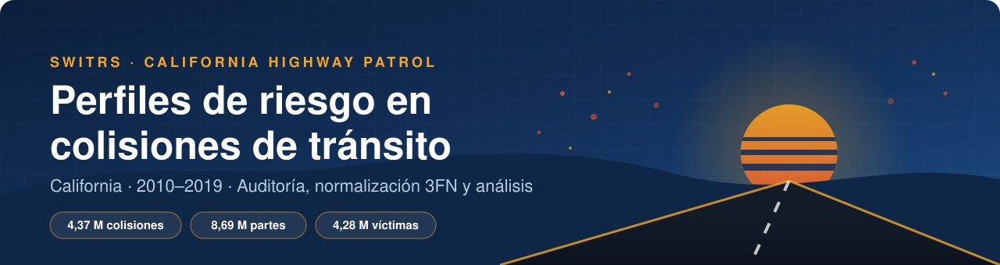
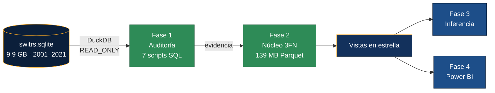
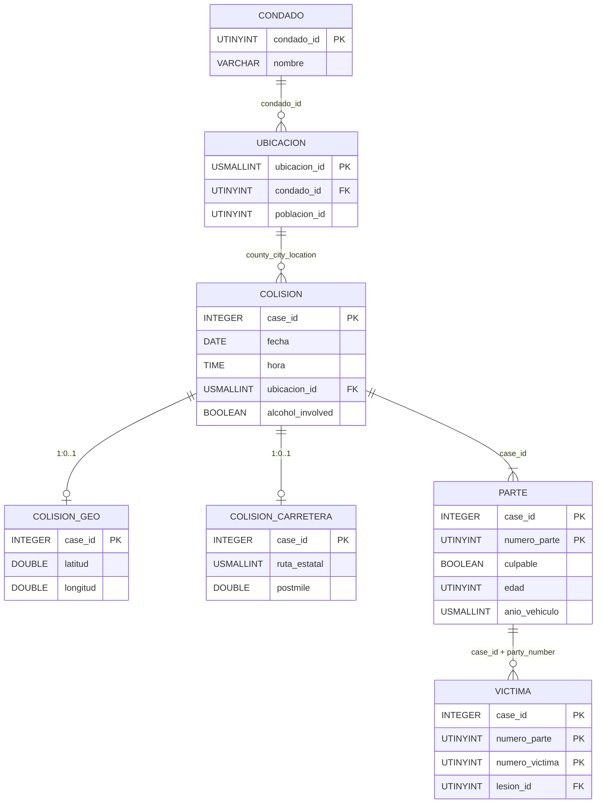

<div align="center">



<br/>

[](#-alcance-y-limitaciones-metodológicas)
[](#-referencias)
[](auditoria/RESULTADOS_AUDITORIA.md)
[](base_de_datos/MODELADO_DE_DATOS.md)

[](https://duckdb.org)
[](https://www.sqlite.org)
[](auditoria)
[](requirements.txt)
[](data/processed)
[](#%EF%B8%8F-hoja-de-ruta)
[](https://github.com/allan230807/analisis-colisiones-california/commits/main)

**Escuela de Estadística y Ciencias Actuariales (EECA-UCV) · Cátedra de Computación II**

[Planteamiento](#-planteamiento-del-problema) ·
[Objetivos](#-objetivos-específicos) ·
[Alcance](#-alcance-y-limitaciones-metodológicas) ·
[Modelo de datos](#-modelo-de-datos-objetivo) ·
[Ejecución](#-ejecución-de-la-auditoría) ·
[Base de datos](#%EF%B8%8F-base-de-datos-normalizada) ·
[Hoja de ruta](#%EF%B8%8F-hoja-de-ruta) ·
[Informe de auditoría](auditoria/RESULTADOS_AUDITORIA.md) ·
[Diccionario de datos](base_de_datos/DICCIONARIO_DE_DATOS.md)

</div>

---

Investigación descriptiva e inferencial sobre **colisiones de tránsito en California durante el período decenal 2010–2019** a partir del registro oficial **SWITRS** (*Statewide Integrated Traffic Records System*), administrado por la *California Highway Patrol* (CHP).

<div align="center">

| 🚗 Colisiones | 👥 Partes involucradas | 🩹 Víctimas | 📅 Días con datos | 🗺️ Condados | 💾 Fuente → Parquet |
|:---:|:---:|:---:|:---:|:---:|:---:|
| **4.368.293** | **8.688.142** | **4.280.801** | **3.652 / 3.652** | **58** | **9,9 GB → 139 MB** |

</div>

> [!NOTE]
> **Estado del proyecto:** las Fases 1 (auditoría) y 2 (normalización 3FN) están completadas y verificadas. La base normalizada está en [`data/processed/`](data/processed) como Parquet. La Fase 3 (inferencia) es la siguiente.

---

## 📌 Planteamiento del problema

La seguridad vial constituye un problema crítico de salud pública. La Organización Mundial de la Salud (OMS, 2023) estimó que las lesiones viales son una de las principales causas de muerte en personas de 5 a 29 años a nivel global.

En California, el sistema **SWITRS** recopila reportes policiales estandarizados sobre colisiones, conductores, vehículos y víctimas. Para estudiar este fenómeno con rigor estadístico y metodológico, este proyecto analiza la serie decenal **2010–2019**, correspondiente a 10 años continuos de registros oficiales previos a las distorsiones de movilidad derivadas de la pandemia.

## 🎯 Pregunta y objetivo general

> [!IMPORTANT]
> **¿Qué patrones temporales y geográficos presentan las colisiones registradas en California durante 2010–2019, y qué asociaciones se observan entre la edad del conductor, la severidad de la colisión, las condiciones de iluminación y meteorológicas, y el año-modelo del vehículo involucrado?**

**Objetivo general:** analizar los registros de colisiones de tránsito de California correspondientes al período 2010–2019 mediante técnicas de estadística descriptiva e inferencial, para identificar patrones temporales y espaciales, describir las condiciones ambientales registradas y examinar las asociaciones entre la edad del conductor, la severidad del evento y el año-modelo del vehículo, dejando los datos normalizados, tipados y optimizados para su explotación analítica en un tablero interactivo.

## 📋 Objetivos específicos

| # | Pregunta específica | Objetivo específico | Variables clave auditadas |
|:---:|---|---|---|
| **1** | ¿Qué patrones temporales y espaciales presentan las colisiones entre 2010 y 2019 según año, mes, día de semana, hora y condado? | Describir patrones temporales y geográficos mediante frecuencias y proporciones decenales. | `collision_date`, `collision_time`, `county_city_location` → `county_location` |
| **2** | ¿Existe asociación estadísticamente significativa entre la edad del conductor culpable y la gravedad de la colisión? | Evaluar mediante contrastes de hipótesis la asociación entre la edad del conductor culpable (a lo sumo uno por colisión) y la severidad registrada. | `party_age`, `party_type`, `at_fault`, `collision_severity` |
| **3** | ¿Cómo se distribuyen las colisiones según las condiciones ambientales reportadas? | Caracterizar la distribución de siniestros según iluminación y clima reportados. | `weather_1`, `lighting` |
| **4** | ¿Qué patrones se observan entre el año-modelo del vehículo y la severidad de las lesiones de sus ocupantes? | Examinar la relación entre el año de fabricación del vehículo y la lesión de las víctimas asociadas a ese vehículo (distinguiendo recuento de riesgo relativo). | `vehicle_year`, `victim_degree_of_injury` homologada a KABCO |
| **5** | ¿Cómo estructurar una fuente de ~9,9 GB para analizarla y visualizarla de forma eficiente? | Diseñar un modelo normalizado en 3FN, tipado y sin columnas derivables, y una capa de vistas en estrella que alimente un tablero en Power BI con filtros cruzados. | Claves, dependencias funcionales, columnas derivables, tipos físicos y medidas sobre el grano correcto |

## 🔬 Alcance y limitaciones metodológicas

| | Aspecto | Decisión |
|:---:|---|---|
| 📅 | **Período de estudio** | 1 de enero de 2010 al 31 de diciembre de 2019 inclusive: 4.368.293 colisiones verificadas y 3.652 días con datos. |
| 🗺️ | **Cobertura geográfica** | Los 58 condados del estado de California. |
| 📍 | **Georreferenciación** | El 49,44% de las colisiones tiene coordenadas válidas (lat 32°–43° N, lon -125° a -114° O) y el 50,56% no tiene. Las coordenadas van a una tabla satélite `1:0..1`, sin imputación. |
| 🍺 | **Variable de alcohol** | `alcohol_involved` solo registra presencia confirmada (`1`, 10,09%) o no reportado (`NULL`, 89,91%). No contiene ceros y no se imputa como sobriedad verificada. |
| 🚙 | **Año del vehículo** | `vehicle_year` se preserva en el rango verificado 1900–2020 para el Objetivo 4. Un conteo de siniestros no equivale a una tasa de riesgo sin denominadores de exposición (parque circulante o millas recorridas). |
| 🧑‍✈️ | **Unidad de análisis del Objetivo 2** | Hay 1,78 conductores por colisión en promedio. Se usa el conductor culpable (`at_fault = 1`), presente en el 93,05% de las colisiones y nunca más de uno, para no contar una colisión varias veces. |
| 🩺 | **Lesión de víctimas desde 2017** | SWITRS recodificó `victim_degree_of_injury` en 2017–2018 y desde 2017 registra ~65% menos víctimas ilesas. La lesión se homologa a KABCO (K, A, B, C, O); la severidad se compara con K–C. |
| 🛰️ | **Cobertura de coordenadas por año** | Crece de 34,3 % (2010) a 64,1 % (2019). Las comparaciones entre años usan el condado; las coordenadas, solo dentro de un mismo año. |
| ❓ | **Edad faltante del culpable** | Falta en el 2,2 % de los conductores culpables sin fuga, pero en ~70 % de los que huyeron. No es un faltante al azar: el Objetivo 2 se analiza con y sin colisiones con fuga. |
| ♻️ | **Redundancia de la fuente** | 21 columnas son recalculables desde el detalle (conteos de víctimas, `party_count`, `collision_severity`, banderas de tipo de colisión). No se almacenan: se calculan en vistas. |

> [!WARNING]
> El total anual de víctimas cae de 529.156 (2016) a 366.353 (2017). No es una baja real de la siniestralidad, sino la menor captura de víctimas ilesas. Ver la sección B.9 del [informe de auditoría](auditoria/RESULTADOS_AUDITORIA.md).

## 📐 Plan de análisis (Fase 3)

Decisiones metodológicas tomadas antes de analizar, a partir de la auditoría:

| Objetivo | Unidad y variables (vistas) | Método | Cuidados |
|:---:|---|---|---|
| **1** | Colisión: `fecha`, `hora`, `condado_id` (`vw_hecho_colision`) | Frecuencias, proporciones y series; tasas por día de calendario | Coordenadas solo dentro de un mismo año (cobertura creciente). |
| **2** | Colisión con conductor culpable: `edad_conductor_culpable` (bandas) vs. `severidad_id` | Tablas de contingencia con **tamaño de efecto** (V de Cramér, razones de probabilidades) y **regresión logística ordinal** | Con millones de filas cualquier contraste es significativo: se informa el efecto, no solo el valor p. Análisis con y sin fugas (edad faltante no aleatoria). |
| **3** | Colisión: `clima_id`, `iluminacion_id`, `superficie_id` | Distribuciones y comparación de severidad por condición | Las condiciones adversas son poco frecuentes: comparar proporciones, no conteos. |
| **4** | Víctima: `edad_vehiculo` (año de la colisión − año-modelo) vs. lesión KABCO (`vw_hecho_victima`) | Proporción de lesiones graves o mortales por edad del vehículo; **modelo multivariado** controlando tipo de vehículo, edad del conductor y tipo de colisión | Un conteo no es un riesgo (no hay datos de exposición); severidad con K–C por la ruptura de ilesos en 2017. |

## 🧭 Flujo del proyecto



## 🧱 Modelo de datos objetivo

Diseño que se desprende de la auditoría (sección D del [informe](auditoria/RESULTADOS_AUDITORIA.md)) e implementado en [`base_de_datos/`](base_de_datos): un **núcleo en 3FN** como almacenamiento y una **capa de vistas en estrella** para el consumo en Power BI. Los 30 catálogos (clima, iluminación, lesión KABCO, tipo de vehículo, etc.) se omiten del diagrama; el detalle está en el [modelado de datos](base_de_datos/MODELADO_DE_DATOS.md).



## 📁 Estructura del repositorio

```text
analisis-colisiones-california/
├── README.md                           ← Documentación general del proyecto y estado
├── requirements.txt                    ← Dependencias Python (duckdb fijado)
├── docs/
│   └── Evaluacion_SQL_Formulario_G8.docx ← Cuestionario de SQL avanzado de la cátedra (Formulario G8)
├── assets/
│   └── banner.svg                      ← Banner del README
├── auditoria/                          ← FASE 1: AUDITORÍA INTEGRAL DE DATOS ✅
│   ├── 01_catalogos_frecuencias.sql    ← Categorías, frecuencias y valores centinela
│   ├── 02_volumen_temporal.sql         ← Series anuales, mensuales, semanales, horarias y geográficas
│   ├── 03_nulos_semantica.sql          ← Completitud, nulos y reglas semánticas
│   ├── 04_fanout_rangos.sql            ← Anti fan-out, consistencia de medidas y cuarentena
│   ├── 05_integridad_duplicados.sql    ← Claves primarias, foráneas y orfandad
│   ├── 06_decision_estrella.sql        ← Modelo objetivo: núcleo 3FN + vistas en estrella
│   ├── 07_dependencias_tipos.sql       ← Dependencias funcionales, derivables, tipos y KABCO
│   └── RESULTADOS_AUDITORIA.md         ← Informe técnico con evidencia empírica (2010–2019)
├── base_de_datos/                      ← FASE 2: NORMALIZACIÓN 3FN ✅
│   ├── comun.py                        ← Rutas, período, rangos y definición de catálogos
│   ├── 01_creacion_esquema.py          ← Esquema: 30 catálogos, núcleo 3FN y 3 vistas
│   ├── 02_poblacion_catalogos.py       ← Catálogos en español, KABCO, calendario, ubicación
│   ├── 03_procesamiento_carga.py       ← Carga del núcleo + 20 controles de integridad
│   ├── 04_exportacion_parquet.py       ← Exportación a Parquet particionado por año
│   ├── DICCIONARIO_DE_DATOS.md         ← Campo por campo: tipo, llave, procedencia, nulos
│   └── MODELADO_DE_DATOS.md            ← Decisiones de diseño y su evidencia
└── data/
    ├── raw/switrs.sqlite               ← Fuente SWITRS (~9,9 GB, no versionada)
    └── processed/                      ← Base normalizada en Parquet (139 MB, versionada)
        ├── catalogos/                  ← 30 catálogos
        └── colision/ · colision_geo/ · colision_carretera/ · parte/ · victima/   ← 1 archivo por año
```

Directorios previstos para las fases siguientes (aún no existen): `notebooks/` (inferencia) y `visualizaciones/` (Power BI).

## ⚙️ Requisitos

| Herramienta | Uso |
|---|---|
| **DuckDB CLI ≥ 1.1** | Ejecuta los scripts de auditoría sobre el SQLite en modo solo lectura. |
| **`data/raw/switrs.sqlite`** | Fuente original SWITRS, descargada y ubicada en esa ruta. |
| **Python 3.10+** | Pipeline de normalización (`base_de_datos/`). `requirements.txt` fija `duckdb==1.5.6`: con la misma versión el Parquet exportado es idéntico byte a byte. |

```bash
python3 -m venv venv && venv/bin/pip install -r requirements.txt
```

## 🚀 Ejecución de la auditoría

Los scripts operan en modo solo lectura (`READ_ONLY`): no alteran la fuente ni crean tablas en ella. Usan la ruta relativa `data/raw/switrs.sqlite`, por lo que deben ejecutarse **desde la raíz del repositorio**.

```bash
# 1. Catálogos y frecuencias de variables categóricas
duckdb -dark-mode < auditoria/01_catalogos_frecuencias.sql

# 2. Análisis temporal (año, mes, día, hora) y espacial (condado)
duckdb -dark-mode < auditoria/02_volumen_temporal.sql

# 3. Semántica de nulos y banderas de siniestros
duckdb -dark-mode < auditoria/03_nulos_semantica.sql

# 4. Verificación de medidas aditivas y rangos atípicos
duckdb -dark-mode < auditoria/04_fanout_rangos.sql

# 5. Integridad referencial de claves primarias y registros huérfanos
duckdb -dark-mode < auditoria/05_integridad_duplicados.sql

# 6. Matriz de cardinalidad y modelo objetivo (núcleo 3FN + vistas estrella)
duckdb -dark-mode < auditoria/06_decision_estrella.sql

# 7. Dependencias funcionales, columnas derivables, tipos físicos y homologación KABCO
duckdb -dark-mode < auditoria/07_dependencias_tipos.sql
```

## 🗄️ Base de datos normalizada

El pipeline de [`base_de_datos/`](base_de_datos) construye la base en DuckDB y la exporta a Parquet. Cada paso se ejecuta desde esa carpeta:

```bash
cd base_de_datos
../venv/bin/python 01_creacion_esquema.py      # esquema 3FN + vistas (recrea la base)
../venv/bin/python 02_poblacion_catalogos.py   # 30 catálogos
../venv/bin/python 03_procesamiento_carga.py   # carga del núcleo y 20 controles (~5 min)
../venv/bin/python 04_exportacion_parquet.py   # data/processed/ (80 archivos, 139 MB)
```

| Tabla del núcleo | Grano | Filas |
|---|---|---:|
| `colision` | colisión | 4.368.293 |
| `colision_geo` | colisión con coordenadas (1:0..1) | 2.159.739 |
| `colision_carretera` | colisión en carretera estatal (1:0..1) | 904.581 |
| `parte` | parte implicada | 8.688.142 |
| `victima` | víctima | 4.280.801 |

> [!TIP]
> No hace falta la fuente de 9,9 GB para analizar: los Parquet de `data/processed/` se consultan directamente con DuckDB, pandas o Power BI. Ver el ejemplo en el [modelado de datos](base_de_datos/MODELADO_DE_DATOS.md#5-del-modelo-a-parquet).

## 🗺️ Hoja de ruta

| Fase | Descripción | Estado |
|:---:|---|:---:|
| **1** | **Auditoría integral y calidad de datos.** Los 7 scripts SQL se ejecutan directamente sobre DuckDB (se eliminó `validar_auditoria.py`). Resultados en [`RESULTADOS_AUDITORIA.md`](auditoria/RESULTADOS_AUDITORIA.md). | ✅ Completada |
| **2** | **Normalización y pipeline ETL.** Núcleo 3FN (`colision`, `colision_geo`, `colision_carretera`, `parte`, `victima`) y 30 catálogos con `id = 0 Sin clasificar`; tipado mínimo sin columnas derivables; 3 vistas en estrella; 20 controles de integridad; Parquet particionado por año (9,9 GB → 139 MB). Ver [`base_de_datos/`](base_de_datos). | ✅ Completada |
| **3** | **Análisis inferencial y modelado estadístico.** Contrastes de hipótesis sobre edad del conductor vs. severidad y modelos multivariados. | ⏳ Pendiente |
| **4** | **Tablero ejecutivo en Power BI.** Navegación temporal y geográfica con filtros cruzados. | ⏳ Pendiente |

## 📚 Referencias

<details>
<summary>Ver bibliografía</summary>

<br/>

- California Highway Patrol. (s. f.). *Annual report of fatal and injury motor vehicle traffic collisions*. SWITRS.
- Hanrahan, R. B., Layde, P. M., Zhu, S., Guse, C. E., & Hargarten, S. W. (2009). The association of driver age with traffic injury severity in Wisconsin. *Traffic Injury Prevention*, 10(4), 361–367.
- Kimball, R., & Ross, M. (2013). *The Data Warehouse Toolkit: The Definitive Guide to Dimensional Modeling* (3rd ed.). Wiley.
- National Highway Traffic Safety Administration. (2013). *How vehicle age and model year relate to driver injury severity in fatal crashes* (Report No. DOT HS 811 825).
- Organización Mundial de la Salud. (2023). *Informe sobre la situación mundial de la seguridad vial 2023: resumen*. OMS.

</details>

---

<div align="center">

<sub>Hecho con 🦆 DuckDB · Datos: SWITRS (California Highway Patrol) · EECA-UCV, Computación II</sub>

</div>
