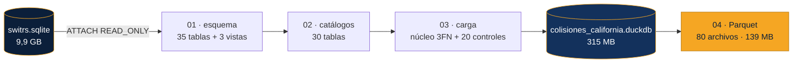
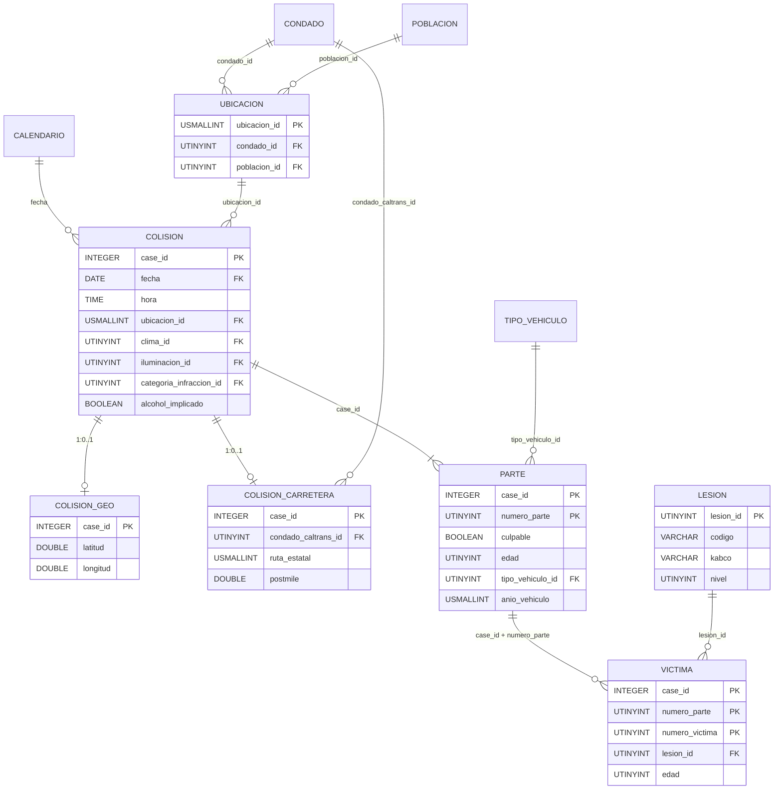

# Modelado de datos

Diseño de la base normalizada del proyecto **"Perfiles de riesgo en colisiones de tránsito — California (2010–2019)"**. Cada decisión se apoya en una evidencia de la auditoría ([`auditoria/RESULTADOS_AUDITORIA.md`](../auditoria/RESULTADOS_AUDITORIA.md)); entre paréntesis se cita el control que la sustenta (por ejemplo, `07-N06`).

---

## 1. Punto de partida: la fuente cruda

`data/raw/switrs.sqlite` (9,9 GB, 2001–2021) es la exportación del *Statewide Integrated Traffic Records System* de la California Highway Patrol.

| Tabla | Filas totales | Filas 2010–2019 | Uso en el modelo |
|---|---:|---:|---|
| `collisions` | 9.424.334 | 4.368.293 | `colision`, `colision_geo`, `colision_carretera`, `ubicacion` |
| `parties` | 18.669.166 | 8.688.142 | `parte` |
| `victims` | 9.639.334 | 4.280.801 | `victima` |
| `case_ids` | 9.424.334 | 4.368.293 | No se migra: redundante con `collisions` |

### 1.1. Problemas estructurales que resuelve el modelo

| Problema de la fuente | Evidencia | Solución en el modelo |
|---|---|---|
| Sin índices; casi todo es `TEXT` | Esquema SQLite | DuckDB columnar; tipos mínimos (`INTEGER`, `DATE`, `TIME`, `UTINYINT`). |
| 21 columnas derivables de otras tablas | 07-N06 a N10 | No se almacenan; se recalculan en vistas. |
| Dependencia transitiva `county_city_location → condado, población` | 07-N04 | Catálogo `ubicacion`. |
| Bloque Caltrans nulo en el 79 % de las filas | 07-N12 | Subtipo `colision_carretera` 1:0..1. |
| Coordenadas nulas en el 50,56 % | 03-C03, 04-D1 | Subtipo `colision_geo` 1:0..1. |
| Banderas `1`/NULL que nunca valen 0 | 03-C02 | `BOOLEAN` TRUE/NULL; NULL = no reportado. |
| Códigos basura (`'N'`, `'2'`, `'04'`, `'Z'`...) | 07-N13 | id 0 "Sin clasificar" en cada catálogo. |
| Recodificación de la lesión en 2017–2018 | 07-N14/N15 | Catálogo `lesion` homologado a KABCO. |
| `parties.id` y `victims.id` no son únicos; `victims` sin número de víctima | 05-A03/A04/A06 | PK compuestas y `numero_victima` determinista. |
| Edades 998/999 o > 110; año de vehículo 2021 | 04-C1/C2/C3 | NULL + bandera de cuarentena. |

---

## 2. Arquitectura del pipeline



| Script | Qué hace | Tiempo aprox. |
|---|---|---:|
| `comun.py` | Rutas, período, rangos de cuarentena y definición de los catálogos. | — |
| `01_creacion_esquema.py` | Crea la base desde cero: catálogos, núcleo y vistas. | < 1 s |
| `02_poblacion_catalogos.py` | Llena los 30 catálogos; deriva `ubicacion` verificando su dependencia funcional. | ~15 s |
| `03_procesamiento_carga.py` | Extrae el período una sola vez, transforma, carga el núcleo y ejecuta 20 controles. | ~5 min |
| `04_exportacion_parquet.py` | Exporta catálogos y núcleo a `data/processed/` y verifica leyendo los archivos. | ~15 s |

**Por qué DuckDB y no SQLite.** La fuente no tiene índices sobre `case_id`: en SQLite cada unión entre tablas es un recorrido completo por fila. DuckDB resuelve las uniones por dispersión (*hash join*), lee el `.sqlite` directamente sin copiarlo y almacena por columnas. La extracción del período (03) lee la fuente **una sola vez** y trabaja después sobre tablas temporales.

---

## 3. Modelo lógico



El diagrama muestra solo algunos catálogos; la lista completa de campos y relaciones está en el [diccionario de datos](DICCIONARIO_DE_DATOS.md).

### 3.1. Inventario

| Capa | Tabla | Filas | PK |
|---|---|---:|---|
| Núcleo | `colision` | 4.368.293 | `case_id` |
| Núcleo | `colision_geo` | 2.159.739 | `case_id` |
| Núcleo | `colision_carretera` | 904.581 | `case_id` |
| Núcleo | `parte` | 8.688.142 | `(case_id, numero_parte)` |
| Núcleo | `victima` | 4.280.801 | `(case_id, numero_parte, numero_victima)` |
| Catálogo | 24 catálogos de códigos | 4 a 24 cada uno | `<catalogo>_id` |
| Catálogo | `calendario`, `condado`, `poblacion`, `ubicacion`, `severidad`, `banda_edad` | 3.652 / 59 / 9 / 542 / 5 / 7 | ver diccionario |
| Vista | `vw_hecho_colision`, `vw_hecho_parte`, `vw_hecho_victima` | — | grano colisión / parte / víctima |

---

## 4. Decisiones de diseño

### 4.1. Tercera Forma Normal: nada derivable se almacena

Una tabla está en 3FN cuando cada atributo depende solo de su clave. La auditoría recalculó cada columna sospechosa desde las tablas de detalle:

- **19 columnas de `collisions`** (muertos, heridos por grado, peatones/ciclistas/motociclistas muertos y heridos, `party_count`, `collision_severity`, vehículo del culpable y las 4 banderas de tipo de colisión) coinciden con su recálculo en 0 a 6 filas de 4,4 millones.
- **2 columnas de `parties`** (`party_number_killed`, `party_number_injured`) coinciden en el 100 %.

Almacenarlas duplicaría información y permitiría que se contradijeran (las 1–6 filas discrepantes de la fuente lo muestran). El núcleo no las guarda; las vistas las recalculan y el control de carga comprueba que el recálculo reproduce los totales oficiales (33.541 muertos, 2.491.217 heridos).

`county_city_location` determina el condado y la categoría de población sin una sola excepción (07-N04): ambos salen de `colision` hacia el catálogo `ubicacion`. Las dependencias que **no** se cumplen (`jurisdiction → condado`, `pcf_violation → categoría`) dejan esos campos como atributos de la colisión.

### 4.2. Llaves verificadas y no declaradas

DuckDB implementa cada `PRIMARY KEY` y cada `FOREIGN KEY` con un índice ART. Sobre tablas de millones de filas, esos índices pesan mucho más que los datos. Se midió con la base cargada:

| Variante | Tamaño de la base |
|---|---:|
| PK y FK declaradas en el núcleo | ≈ 3,4 GB |
| Solo PK declaradas en el núcleo | ≈ 0,7 GB |
| **Sin índices en el núcleo (versión final)** | **315 MB** |

En un motor columnar esos índices no aceleran el análisis, que recorre columnas completas. Por eso:

- los **catálogos** (pocas filas) declaran PK, `UNIQUE` y FK en el motor;
- las **cinco tablas del núcleo** documentan sus llaves y `03_procesamiento_carga.py` las **verifica** en cada carga: unicidad y no nulidad de las 5 PK y un anti-join por cada una de las 37 relaciones FK. Un solo huérfano o duplicado detiene el proceso con código 1.

### 4.3. `case_id` como llave natural

`case_id` es 100 % numérico, sin ceros a la izquierda y con un máximo de 91.463.275 (07-N01), así que se guarda como `INTEGER` de 4 bytes en las tres tablas que lo repiten. No hace falta una llave subrogada: la natural ya es compacta, estable y permite volver a la fuente sin una tabla de equivalencias. `parte` y `victima` usan llaves compuestas que heredan `case_id`.

`victima` no trae número de víctima y su `id` se repite (05-A04). `numero_victima` se asigna con `ROW_NUMBER()` ordenado por ese `id` dentro de cada parte; es determinista porque el `id` no se repite dentro de una parte (05-A06). Las 25.710 víctimas idénticas salvo el `id` se conservan: son personas distintas con el mismo perfil.

### 4.4. Subtipos 1:0..1

- **`colision_geo`**: solo pares completos dentro de California. La existencia de la fila es la bandera `tiene_coordenadas` de la vista.
- **`colision_carretera`**: el bloque Caltrans es nulo o no nulo siempre en conjunto. Separarlo evita 6 columnas vacías en el 79 % de las colisiones y deja explícito que esos atributos solo existen para colisiones en carreteras estatales.

En ambas tablas la PK es a la vez FK a `colision`.

### 4.5. Catálogos y valores sin clasificar

Los 24 catálogos de códigos se escriben a mano en `02_poblacion_catalogos.py`: traducción al español, un `orden` con sentido (el alfabético pone "fatal" antes que "pain") y clasificaciones propias (`grupo`, `es_adverso`, `es_oscuridad`, `kabco`). Todo NULL o código basura cae en el id 0, y la carga informa cuántas filas cayeron ahí y con qué valor de origen. Las columnas de segunda condición (`clima_2_id`, `condicion_via_2_id`, `equipo_seguridad_2_id`) conservan NULL, porque su ausencia significa "no hubo segunda condición".

`ubicacion` es el único catálogo derivado de la fuente. Antes de insertarlo, el script comprueba la dependencia funcional y que los dos primeros dígitos de `county_city_location` correspondan al código oficial del condado; si no, se detiene.

### 4.6. Semántica de los NULL

| Caso | Tratamiento |
|---|---|
| `alcohol_implicado`, `materiales_peligrosos`, `relacion_bus_escolar` | TRUE o NULL. La fuente solo registra la presencia; convertir NULL en FALSE afirmaría una sobriedad o ausencia que nadie verificó. |
| `hora` | NULL = hora desconocida. No se imputa 00:00, que inflaría las colisiones de medianoche. |
| `edad`, `anio_vehiculo` fuera de rango | NULL + `*_en_cuarentena = TRUE`. Se distingue el dato inválido del dato ausente y la fila no se pierde. |
| Coordenadas | No se imputan centroides ni ceros. |

### 4.7. Lesión KABCO y severidad derivada

El catálogo `lesion` mapea los 8 códigos de `victim_degree_of_injury` (antes y después de la recodificación de 2017–2018) a la escala KABCO: K muerto, A grave, B visible, C posible o dolor, O ileso. Con esa homologación las series K–C son continuas en la década.

La severidad de la colisión es el nivel KABCO máximo de sus víctimas (0 si no hay lesionados). Coincide con `collision_severity` en todas las colisiones salvo el único código basura `'N'`, que el recálculo clasifica como solo daños materiales.

### 4.8. Vistas en estrella

La capa de consumo no duplica datos: tres vistas unen el núcleo con sus catálogos y recalculan las medidas sobre el grano correcto, de modo que ninguna medida se infla por *fan-out*:

- **`vw_hecho_colision`**: Objetivos 1 y 3, y la severidad para el Objetivo 2 (incluye la edad del culpable, a lo sumo uno por colisión).
- **`vw_hecho_parte`**: Objetivo 2 a grano parte (banda de edad) y año del vehículo.
- **`vw_hecho_victima`**: Objetivo 4 (lesión KABCO de cada ocupante y año-modelo de su vehículo).

---

## 5. Del modelo a Parquet

`04_exportacion_parquet.py` escribe un archivo por año para cada tabla del núcleo; `parte`, `victima` y los subtipos heredan el año de su colisión. Opciones: Parquet V2 (codificación delta para claves ordenadas), ZSTD nivel 9 y filas ordenadas por PK.

| Etapa | Tamaño | Reducción frente a la fuente |
|---|---:|---:|
| Fuente SQLite completa (2001–2021) | 9,9 GB | — |
| Período 2010–2019 copiado sin tipar a DuckDB | 565 MB | 18× |
| **Base normalizada (`.duckdb`)** | **315 MB** | **31×** |
| **Parquet normalizado (`data/processed/`)** | **139 MB** | **71×** |

| Carpeta | Archivos | Tamaño | Archivo mayor |
|---|---:|---:|---:|
| `catalogos/` | 30 | 0,03 MB | — |
| `colision/` | 10 | 33,9 MB | 3,8 MB |
| `colision_geo/` | 10 | 27,4 MB | 3,9 MB |
| `colision_carretera/` | 10 | 5,4 MB | 0,9 MB |
| `parte/` | 10 | 58,3 MB | 6,5 MB |
| `victima/` | 10 | 13,9 MB | 1,7 MB |

Ningún archivo se acerca al límite recomendado de GitHub (50 MB), por lo que los Parquet se versionan y el análisis es reproducible sin la fuente cruda. La verificación vuelve a leer los archivos escritos: filas, claves distintas y 33.541 muertos recalculados por KABCO.

Los Parquet se consultan directamente, sin la base `.duckdb` (unas décimas de segundo en DuckDB):

```sql
-- Los 5 condados con más fallecidos, 2010-2019
SELECT d.nombre AS condado, COUNT(*) AS muertos
FROM 'data/processed/victima/*.parquet' v
JOIN 'data/processed/catalogos/lesion.parquet' l USING (lesion_id)
JOIN 'data/processed/colision/*.parquet' c USING (case_id)
JOIN 'data/processed/catalogos/ubicacion.parquet' u USING (ubicacion_id)
JOIN 'data/processed/catalogos/condado.parquet' d USING (condado_id)
WHERE l.kabco = 'K'
GROUP BY ALL ORDER BY muertos DESC LIMIT 5;
```

---

## 6. Controles de integridad (03)

| # | Control | Resultado |
|---:|---|---:|
| 1–3 | Filas de `colision`, `parte` y `victima` = filas de la fuente en el período | 4.368.293 · 8.688.142 · 4.280.801 |
| 4–5 | Filas de `colision_geo` y `colision_carretera` = casos válidos en la fuente | 2.159.739 · 904.581 |
| 6 | Muertos de la vista = `SUM(killed_victims)` | 33.541 |
| 7 | Heridos de la vista = `SUM(injured_victims)` | 2.491.217 |
| 8 | Severidad derivada distinta de `collision_severity` (excepto `'N'`) | 0 |
| 9 | Banderas peatón/ciclista/moto/camión distintas de la fuente | 0 |
| 10 | Condado de `ubicacion` distinto de `county_location` | 0 |
| 11 | Colisiones con más de un culpable | 0 |
| 12–14 | Edades de partes, edades de víctimas y años de vehículo en cuarentena = casos fuera de rango en la fuente | 38 · 171 · 2 |
| 15–19 | Duplicados o nulos en las 5 PK del núcleo | 0 |
| 20 | Huérfanos en las 37 relaciones FK del núcleo | 0 |

---

## 7. Reproducción

Desde la raíz del repositorio, con la fuente en `data/raw/switrs.sqlite` (o la ruta indicada en `SWITRS_PATH`):

```bash
python3 -m venv venv && venv/bin/pip install -r requirements.txt
cd base_de_datos
../venv/bin/python 01_creacion_esquema.py
../venv/bin/python 02_poblacion_catalogos.py
../venv/bin/python 03_procesamiento_carga.py
../venv/bin/python 04_exportacion_parquet.py
```

`01` borra y recrea la base, así que la secuencia completa es siempre reproducible. La base `.duckdb` no se versiona; los Parquet de `data/processed/` sí.
